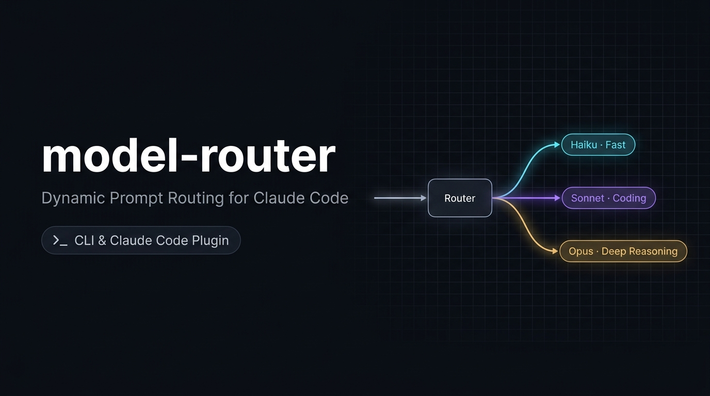
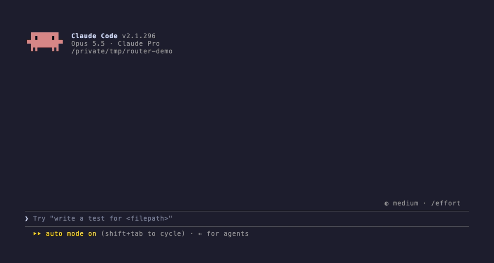

# model-router



Designed to reduce your [Claude Code](https://claude.com/claude-code) costs and usage by sending each prompt to the **cheapest model that can handle it**. Before your prompt is answered, Claude Haiku reads it on low effort and picks haiku, sonnet or opus plus an effort level. Trivial questions go to Haiku. Hard architecture work goes to Opus.



It comes in two forms:

| | **Plugin** (recommended) | **`model-router` CLI** |
|---|---|---|
| Where it runs | Inside Claude Code: terminal, and the desktop app's Code tab | Your terminal, as a wrapper around `claude` |
| Routing | **Every prompt**, mid-session | Once, on the first prompt of a session |
| Install | `/plugin install` or `install.sh` | `install.sh` |

## Install

**One line**, which installs both the plugin and the `model-router` command:

```bash
curl -fsSL https://raw.githubusercontent.com/DuffyEthan/model-router/main/install.sh | sh
```

Use `--plugin-only` or `--cli-only` to install just one: `... | sh -s -- --plugin-only`.

The installer always downloads the `model-router` command from a pinned release tag (currently `v0.2.1`) and checks its SHA-256 against the value in `install.sh` before installing; it never copies files from the current directory. The plugin install follows the default branch, because `claude plugin install` can't pin a tag.

**Or install just the plugin** from a terminal:

```bash
claude plugin install model-router --marketplace DuffyEthan/model-router
```

or from inside an interactive Claude Code terminal session:

```
/plugin install model-router --marketplace DuffyEthan/model-router
```

Answer `y` to add the marketplace, then pick a scope. *User* scope enables the plugin in every session.

**Claude desktop app:** the Code tab can't run `/plugin`, but it loads plugins installed at User scope. Install with either command above from a terminal, then start a new Code session and type `/router` to check it's on.

Requirements: Claude Code 2.1.275 or later for the plugin, and Python 3.9+ for the CLI. The plugin uses your normal Claude Code login, so it works on a Pro/Max subscription (where it aims to stretch usage limits) or with an API key (where it aims to save money).

## The plugin

Once it's installed, routing just happens.

If you use subagents or background tasks a lot, also run `/router background sonnet` once. The classifier never sees them, so by default they run on your session model, which is often Opus at full price. This sends them to Sonnet instead and is remembered across sessions. See [`/router background`](#router-background).

### How it works, step by step

When you send a prompt, Haiku makes a quick decision first, then that turn's requests are rewritten to use the model and effort it picked. The plugin's entry point is [`plugin/hooks/register.ts`](plugin/hooks/register.ts), with the switch-cost check in `switch.ts` and the routing log in `tracker.ts`. It hooks into several points in Claude Code; the four that matter most are:

```
You type a prompt
   │
   ▼
① prompt.submit hook ── Haiku (low effort) ──► {"model":"sonnet","effort":"medium","reason":"..."}
   │                      reads: your new message + last ~4 messages (trimmed)
   │                      status line: "router → sonnet · medium"
   ▼
Claude Code builds the request as normal (full conversation, CLAUDE.md, tools…)
   │
   ▼
② turn.step hook ── rewrites ONLY model + effort ──► claude-sonnet-5-5 @ medium
   │                 (fires on every request in the turn: each step of the tool-call loop)
   ▼
Sonnet answers, edits files, runs tools… until the turn ends
   │
   ▼
Next prompt → back to ①, fresh decision
```

**① Classifying (`prompt.submit`).** This runs before your message enters the conversation.
- The plugin sends Haiku a short router prompt describing the three tiers: Haiku for trivial things, Sonnet for everyday coding, Opus for hard or high-stakes work.
- Haiku also gets the last few messages, so a follow-up like "yes, do it" is judged by the task it refers to.
- It's a separate one-off call (`$.model.complete`) that typically takes 1–3 seconds, with a 20-second timeout and a 300-token answer cap. It has no tools and no history, and nothing from it goes into your conversation.
- Haiku replies with JSON, which the plugin checks before using. Anything invalid means "no route", and the turn uses your session's normal model.
- The decision appears in the status line, for example `router → sonnet · medium`.

**② Rewriting (`turn.step`).** This runs just before each request Claude Code sends to the API.
- The plugin swaps in the chosen model's full name (e.g. `claude-sonnet-5-5`) and the chosen effort level.
- Everything else is locked by Claude Code: the conversation, the instructions, the tools. That's why context is never affected.
- One turn can make many requests, because the model calls a tool, reads the result and continues. All of them use the routed model.
- Requests from subagents are left alone, unless you set [`/router background`](#router-background) to downgrade them.

**③ Startup (`session.start`).** This loads your on/off setting, which is saved across sessions, and registers the `/router` command.

**④ `/router` (`command.run`).** `on` and `off` turn routing on and off. `status` shows the last decision with Haiku's reason and how many prompts went to each model this session. `stats`, `export`, `floor`, `ceiling`, `background` and `sticky` are covered in [Commands](#commands) and below.

**Where the savings are meant to come from:** the model doing the work in that turn is what you pay for. Each Haiku check costs about $0.0002 (see [Cost of a classification](#cost-of-a-classification)). If it sends a quick question to Haiku instead of Opus, that answer usually costs a small fraction of what it would have, and effort set to `low` cuts thinking tokens further. See [Benefits and drawbacks](#benefits-and-drawbacks) for when a switch gets expensive, including long sessions where Haiku can cost more than staying on Opus.

### Cost of a classification

One classification is one Haiku 5.5 call at low effort. What it sends, from `classify()` in [`register.ts`](plugin/hooks/register.ts):

| Part | Size | Tokens (estimated at ~4 characters per token) |
|---|---|---|
| `SYSTEM` router prompt | 1,438 characters | ~360 |
| Conversation tail: last 4 messages, each cut to 600 characters | up to 2,400 characters | 0–600 |
| Your new message, cut to 8,000 characters, plus the wrapper tags | usually a sentence or two | ~50–100 typical, ~2,000 max |
| **Input total** | | **~1,000 typical mid-session**, ~3,000 max |
| Output: the JSON decision plus any low-effort thinking, capped by `maxTokens: 300` | | **~150 typical**, 300 max |

At Haiku 5.5 prices (prompts up to 100K tokens: $0.10 per million input tokens, $0.50 per million output tokens):

```
typical:  1,000 × $0.10/M + 150 × $0.50/M = $0.00010 + $0.000075 ≈ $0.0002
maximum:  3,000 × $0.10/M + 300 × $0.50/M = $0.00030 + $0.00015  ≈ $0.00045
```

So a classification costs **about $0.0002**, or roughly $0.02 per 100 prompts. The token counts are estimates, not measurements. `evals/routing_eval.py` prints the measured per-call cost reported by Claude Code if you want to check it.

### Commands

| Command | What it does |
|---|---|
| `/router` or `/router status` | Show on/off, the last decision and why, and the routing counts for this session |
| `/router off` | Stop routing and use the session's model (remembered across sessions) |
| `/router on` | Turn routing back on |
| `/router stats` | Summarise the routing log, and show the current floor, ceiling, background and sticky settings (see [Measure it yourself](#measure-it-yourself)) |
| `/router export [path]` | Write the routing log as JSON Lines (default `~/.claude/model-router/routing-log.jsonl`) |
| `/router floor [haiku\|sonnet\|opus]` | Set the lowest model the router may pick, or show it (see [`/router floor`](#router-floor)) |
| `/router ceiling [haiku\|sonnet\|opus]` | Set the highest model the router may pick, or show it (see [`/router ceiling`](#router-ceiling)) |
| `/router background [session\|sonnet\|haiku] [effort]` | Set the tier for background notifications and subagents (see [`/router background`](#router-background)) |
| `/router sticky [on\|off]` | Hold a downgrade back when the cache switch would cost more (see [`/router sticky`](#router-sticky)) |

A tested example, with sessions started with `--model opus`:

```
"What is 2+2?"                                   → answered by claude-haiku-5-5  ($0.0007)
"Write is_palindrome(s) in Python"               → answered by claude-haiku-5-5  ($0.0003)
"Zero-downtime plan to shard a 5TB Postgres..."  → answered by claude-opus-5-5   ($0.0445)
```

### `/router floor`

`/router floor haiku|sonnet|opus` sets the lowest model the router may pick. When the classifier picks a cheaper tier, the floor tier answers instead, at the classifier's effort. `/router floor` on its own shows the current floor, and `/router status` and `/router stats` show it too. The default is `haiku`, which means no floor. The setting is remembered across sessions. It never changes turns the router leaves alone, such as slash commands, background notifications, subagents and classifier failures.

```
/router floor sonnet     # simple prompts go to Sonnet instead of Haiku; hard ones still go to Opus
```

In a small test, Haiku answered simple standalone questions as well as Sonnet did, so the default is fine for most people. The floor lets you opt out of Haiku answers anyway.

### `/router ceiling`

`/router ceiling haiku|sonnet|opus` sets the highest model the router may pick, the opposite of the floor. When the classifier picks a more expensive tier, the ceiling tier answers instead, at the classifier's effort. `/router ceiling sonnet` caps spend by never routing to Opus; switch the session model with `/model` when a task really needs it. `/router ceiling` on its own shows the current ceiling, and `/router status` and `/router stats` show it too. The default is `opus`, which means no ceiling. The setting is remembered across sessions. Like the floor, it never changes turns the router leaves alone, and it doesn't cap the `/router background` tier. With `/router sticky` on, a cheaper pick is never held on a warm model above the ceiling.

The floor can't be set above the ceiling, or the ceiling below the floor; the command says which to change first. Setting both to the same tier sends every routed prompt to that tier.

```
/router ceiling sonnet   # hard prompts go to Sonnet instead of Opus; simple ones still go to Haiku
```

### `/router background`

`/router background session|sonnet|haiku` sets the tier for background notifications (`task-notification`, `peer`, etc.) and subagents. In long-running sessions started with `--model opus`, background tasks and subagents otherwise run on Opus at full price, consuming most of the session's tokens. Setting the background tier to `sonnet` (effort `medium`) or `haiku` (effort `low`) routes them to a cheaper model while keeping interactive prompts routed normally. Add an effort to override the default, for example `/router background sonnet high` for subagents doing long implementation work; `/router background sonnet` on its own goes back to the tier's default effort. Subagents are only ever downgraded: one already on the background tier or a cheaper one (such as a Haiku `Explore` agent) keeps its own model and effort. The default is `session` (run on the session model). The setting is remembered across sessions.

```
/router background sonnet   # route background notifications and subagents to Sonnet
/router background haiku    # route background notifications and subagents to Haiku
/router background sonnet high   # the same on Sonnet, at high effort
```

### `/router sticky`

The prompt cache is per model. Every main-thread request already carries about 35K tokens (system prompt and tools) even at the start of a session, and real sessions run to 100K and more. Moving a turn to a cheaper model first writes that whole context to the new model's cache, and coming back writes it to the old model's cache again. On real transcripts those writes cost about twice what the cheaper turns saved.

With `/router sticky on` (the default), when the classifier picks a tier cheaper than the one the main thread last ran on, the router compares the two:

- **Switch cost:** the context × the target's cache-write price, plus the context × the warm model's cache-write price for the return. Writes are priced at the 5-minute rate, or the 1-hour rate once the session shows it writes 1-hour cache.
- **Saving:** what an assumed turn (3 requests, 5K new input tokens, 2K output tokens) costs on the warm model, minus what it costs on the cheaper one.

If the switch costs more, the turn stays on the warm model at the classifier's effort. The context size and model come from the usage the API reported for the main thread's last request, not from an estimate. Prices come from [`prices.json`](plugin/hooks/prices.json), including Haiku's long-context rates above 100K tokens. Escalations are never held back. Nothing is held back when the warm model's cache has expired (it last answered more than five minutes ago, or more than an hour ago in a session that writes 1-hour cache), after a compaction, or when the last request reported no usage.

Claude Code writes 5-minute or 1-hour cache. The router treats a session as writing 1-hour cache once a main-thread request reports 1-hour cache writes, or once a request sent more than five minutes after the previous one, on the same model, reads at least 80% of that request's prompt from cache. Until then it assumes 5 minutes.

At current prices, staying wins above about 5K tokens of context for Opus → Sonnet, 15K for Opus → Haiku and 14K for Sonnet → Haiku. Every real request is larger than that, so in practice a session with a warm cache only moves up. `/router status` shows a held-back pick as `kept on opus: switch to haiku would cost more` with both estimates, and `/router stats` counts them. Background routes and subagents are not affected. `/router sticky off` switches on every pick, as before. The setting is remembered across sessions.

```
/router sticky off   # always follow the classifier, whatever the cache
```

## The `model-router` CLI

```bash
model-router "prompt"                  # route, then open interactive Claude Code on that model
model-router -p "prompt"               # route, then run headless and print the answer
model-router --dry-run "prompt"        # only show the decision
model-router --model opus "prompt"     # skip routing
model-router --floor sonnet "prompt"   # route, but never below sonnet
model-router --ceiling sonnet "prompt" # route, but never above sonnet
echo "prompt" | model-router -p        # prompt from stdin
```

Before v0.2.2 this command was called `route`. That name clashes with the system's own `route` tool (`/sbin/route` on macOS and many Linux distributions), which usually comes first on `PATH`. Rerunning the installer adds `model-router` and leaves an old `route` link working, with a note on how to remove it.

How it works: it runs `claude -p --model haiku --effort low` once to get the same JSON decision as the plugin, then starts a normal `claude --model X --effort Y "prompt"` session. It's simpler than the plugin, but it only decides once per session.

To pass other flags to `claude`, put them after `--`: `model-router "prompt" -- --permission-mode plan`. Flags written as `--flag=value` also pass straight through. If the classifier fails (error, timeout or an unusable reply), `model-router` prints a note to stderr and starts `claude` with no `--model` or `--effort` from the router, so you get the session default, like the plugin. `--model` and `--effort` are checked before anything runs; an invalid value exits with an error listing the allowed ones. `--floor haiku|sonnet|opus` (default `haiku`) works like the plugin's `/router floor`: a routed model below the floor is raised to it, keeping the effort. It is checked the same way, and it doesn't change a failed classification or a model forced with `--model`. `--ceiling haiku|sonnet|opus` (default `opus`) is the plugin's `/router ceiling`: a routed model above the ceiling is lowered to it, keeping the effort, with the same exceptions. A `--floor` above the `--ceiling` exits with an error. Decisions are logged to `~/.model-router/log.jsonl`. Each routing call costs about $0.0002, like the plugin's. It typically takes 1–3 seconds, with a 60-second timeout (the CLI's limit is longer than the plugin's 20 seconds).

## Tuning

- **Routing rules:** edit `SYSTEM` in [`plugin/hooks/register.ts`](plugin/hooks/register.ts) (plugin) and `SYSTEM_PROMPT` in [`cli/route.py`](cli/route.py) (CLI). Keep the two identical: `cli/tests/test_prompt_parity.py` fails if they drift. The defaults lean toward the cheaper model when two tiers are close, except for high-stakes work.
- **Model IDs:** the plugin needs full model IDs. When new models ship, update `MODEL_IDS` in `register.ts`.

## Benefits and drawbacks

### Benefits

- **Designed for savings on easy prompts.** On prompts up to 100K tokens, Haiku costs a small fraction of Opus per token: $0.10 vs $4 per million input tokens, and $0.50 vs $20 per million output tokens. (Above 100K tokens, Haiku's prices go up 5×; see the drawbacks.) Quick questions, renames, one-liners and small edits make up a lot of a typical session, and they can be answered for a fraction of a cent.
- **Effort is routed too.** Even when a prompt needs a strong model, a simple one runs at `low` or `medium` effort instead of `xhigh`, which cuts thinking tokens. Changing effort never costs cache.
- **The context stays the same.** Only the model and effort on each request change. Whichever model answers sees the full conversation, CLAUDE.md, memory, tool results and file contents. Every current model has a 1M-token context window, so nothing gets cut off.
- **Routing is cheap and fails safe.** Each classification costs about $0.0002 and runs as a separate call that adds nothing to your conversation. If it fails or times out, the turn runs on the session's normal model.
- **Hard work still gets Opus.** The router leans toward the cheaper tier only when two tiers are close. High-stakes work (production data, security, irreversible actions) is pushed up, not down.
- **It works on subscriptions.** On Pro/Max, cheaper models use up less of your usage limits, so the aim is that you hit them later.

These are design goals. The only usage data so far is the author's: over 10 sessions in October 2026, the router-on turns cost about 29% less than the same work on Opus alone (see [`docs/savings/`](docs/savings/)). That's one person over two days, so measure your own with [`scripts/router_report.py`](#measure-it-yourself).

### Drawbacks

- **Switching models can cost cache.** Prompt caches are per model. The first request on a model that hasn't seen the conversation writes it to that model's cache at above full input price, instead of reading it at the 90–95% cheaper cached price. How much that matters depends on where you switch and how long the conversation is. Haiku 5.5 is also priced by prompt length: a request over 100K input tokens (cache reads and writes included) pays 5× Haiku's normal rates. Opus and Sonnet 5.5 have no such step.

  Per request, assuming ~2K output tokens on either model and 5-minute cache writes:

  | Switch | Context | First step | Later steps | Worth it? |
  |---|---|---|---|---|
  | Stay on Opus (cached) | 20K | ~$0.044 | ~$0.044 | n/a |
  | Opus → **Haiku** (from scratch) | 20K | ~$0.0035 | ~$0.0012 | **Yes.** Even the first step is ~12× cheaper. |
  | Stay on Opus (cached) | 100K | ~$0.06 | ~$0.06 | n/a |
  | Opus → **Sonnet** (from scratch) | 100K | ~$0.27 | ~$0.03 | **Usually not** in long sessions. It only pays off after ~7+ steps on Sonnet. |
  | Stay on Opus (cached) | 150K | ~$0.07 | ~$0.07 | n/a |
  | Opus → **Haiku** (from scratch) | 150K | ~$0.099 | ~$0.0125 | **Only if the turn runs more than one step.** The first step costs ~40% more than staying on Opus; the second step earns it back. |

  How these are worked out (prices per million tokens): Opus cached step = context × $0.20 + 2K × $20. Haiku first step = context × $0.125 (cache write) + 2K × $0.50 up to 100K tokens, or context × $0.625 + 2K × $2.50 over 100K. Haiku later steps use the cache-read price ($0.01, or $0.05 over 100K). Sonnet first step = context × $2.50 + 2K × $10, later steps context × $0.10 + 2K × $10.

  **Where the Haiku crossover is:** with ~2K output, a first Haiku step is cheaper than a cached Opus step at any context up to 100K tokens, and more expensive just past it (~$0.068 vs ~$0.060 just over 100K). Longer answers move the crossover up, because Opus output costs 8× Haiku's long-context output: at ~5K output tokens it sits around 205K tokens of context. With 1-hour cache writes ($1 per million on Haiku over 100K), the first Haiku step costs more again.

  Two things soften this. Caches survive switching: each model keeps its own for a few minutes (up to an hour in some setups), so hopping back to Opus soon afterwards is cheap. And early in a session the context is small, so switching is nearly free. The bad case is a **long conversation that drops from Opus to Sonnet for a turn or two**. If a long session keeps hopping between models, run `/router off`.
- **Hidden reasoning doesn't carry over.** On current models, a model's private reasoning ("thinking") from earlier turns can only be read by that same model. After a switch, the new model sees everything the previous one *said and did*, but not how it reasoned. That rarely matters, because conclusions end up in the visible text, but it can in long, delicate debugging sessions.
- **Haiku can misjudge a prompt.** A hard problem phrased simply can get routed too low, and the answer may be weaker. Check `/router status` to see the reasoning, re-ask with more detail, or run `/router off` for that stretch of work. It also adds latency to every prompt: typically 1–3 seconds, with a 20-second timeout.
- **It overrides your `/model` and `/effort` choices** while it's on. `/router off` hands control back.
- **Savings depend on your mix.** If most of your prompts really are hard, they go to Opus anyway and you pay the small routing overhead for nothing.
- **Subagents aren't classified.** They keep their own configured models and effort, unless `/router background sonnet|haiku` downgrades the ones above that tier.
- **The plugin API is early access.** The `turn.step` / `prompt.submit` hooks may change between Claude Code releases, and model IDs in `register.ts` need updating when new models ship.
- **The CLI routes only once.** `model-router` picks a model for the whole session based on its first prompt. Use the plugin for per-prompt routing.

Prices are Anthropic API list prices from the [pricing page](https://platform.claude.com/docs/en/about-claude/pricing), as of 2026-10 (checked 2026-10-14). Per million tokens:

| Model | Input | 5m cache write | 1h cache write | Cache read | Output |
|---|---|---|---|---|---|
| Opus 5.5 | $4 | $5 | $8 | $0.20 | $20 |
| Sonnet 5.5 | $2 | $2.50 | $4 | $0.10 | $10 |
| Haiku 5.5, prompts up to 100K tokens | $0.10 | $0.125 | $0.20 | $0.01 | $0.50 |
| Haiku 5.5, prompts over 100K tokens | $0.50 | $0.625 | $1 | $0.05 | $2.50 |

Cached reads are billed at 0.05× input price on Opus and Sonnet 5.5 and 0.1× on Haiku 5.5, and cache writes at 1.25×–2× depending on TTL. On a subscription, usage limits follow roughly the same proportions.

## Measure it yourself

Routing only pays if the cheaper turns save more than the classifier and the cache re-writes cost. The plugin keeps a small routing log so you can check this on your own sessions.

**In a session:** `/router stats` summarises the routing log: prompts by route and origin, mid-turn prompts, classifier outcomes and latency, classifier overhead, and overrides. It uses only the plugin's own log, so it has no token or cost figures for the turns themselves.

**Full report:** `scripts/router_report.py` (Python 3.9+, stdlib only) joins the routing log with Claude Code's session transcripts (`~/.claude/projects/<project>/<session>.jsonl`, with subagents under `<session>/subagents/`):

```sh
python3 scripts/router_report.py --since 2026-10-01 --until 2026-10-31
#   --projects-dir DIR   transcripts root (default ~/.claude/projects)
#   --log PATH           routing log: the plugin's store file or a /router export (repeatable)
#   --prices PATH        price table (default plugin/hooks/prices.json)
#   --all-sessions       also count sessions with no routing-log records
#   --simulate POLICY    re-price the same requests under another policy (repeatable, or `all`)
#   --json               machine-readable figures
```

It prints:

- the share of prompts by route (from the log), and of API requests and tokens by model (from the transcripts);
- **spend by source and route**: cost and share for the main thread and for subagents, each split by the route of the prompt the request belongs to (see below);
- the actual cost at API list prices, labelled **API-equivalent**;
- an **Opus-only counterfactual**, with the same tokens priced at Opus;
- **net savings**, with the switch cache penalty and the classifier overhead on separate lines;
- the same figures split into **router on vs off**, when some prompts were sent with `/router off`, so time with the router off doesn't dilute the savings;
- the **override rate**: `/model` changes and `/router off` per user prompt.

Requests from before a session's first routing-log record, such as the start of the session you installed the plugin in, are shown on the scope line as **before routing log** with their cost. They are left out of every other figure, because the router wasn't running for them.

**Spend by source and route.** A main-thread request belongs to the latest prompt in its session logged at or before it. A subagent belongs to the prompt its first request falls under, so all of its requests count towards the prompt that started it. The route buckets are:

- `haiku`, `sonnet` or `opus`: routed by the classifier;
- `background → sonnet`/`haiku`: routed by `/router background`;
- `unrouted: <skip reason>` (`off`, `slash`, `empty`), `unrouted: <origin kind>` for prompts that aren't yours (`peer`, `task-notification`, …), or `unrouted: classifier failed`/`timeout`;
- `before first prompt`: the session's first log record was an override, not a prompt.

The shares show where routing can save money. Main-thread turns routed to Haiku are often a small slice. Subagents, which the classifier never sees, are often the largest.

**Simulating a policy.** `--simulate POLICY` re-prices the same requests as if each had run on the model the policy picks. It always adds `observed` and `opus-only` too, for calibration and as the baseline:

| Policy | Model per request |
|---|---|
| `observed` | the model it actually ran on |
| `opus-only` | Opus |
| `sonnet-only` | Sonnet |
| `sonnet-first` | the routed tier for routed prompts; Sonnet for unrouted prompts and subagents |
| `sonnet-first-floor` | as `sonnet-first`, with the floor at Sonnet (Haiku routes become Sonnet) |
| `background-sonnet` | Sonnet for subagents and prompts that aren't yours; the rest as observed |

For each policy the report prints the cost, the savings against `opus-only` and the number of model switches. The savings subtract the classifier overhead for the policies that run the classifier. Switching models changes which tokens are cache reads, so the cache is modelled again. Each chain (a main thread or a subagent) tracks, per model, when it last ran and the context it left (input + cache reads + cache writes + output). A request reads its cached tokens up to that context while the model's cache is warm: within 5 minutes, or within an hour in a chain that writes 1-hour cache. Everything else is written. The first request of a chain keeps its recorded split. What it read came from outside the chain, mostly the shared system prompt and tools, and that prefix counts as warm on any model.

Two calibration lines check the model against the measured figures: `observed` against the actual cost and `opus-only` against the counterfactual. On the author's sessions from 14–20 Oct 2026, both came within 3%. If yours are far apart, read the simulated savings with care. Like the counterfactual, a simulation keeps every request's tokens and output length, so it can't show a model taking more or fewer turns.

By default the report reads the log straight from the plugin's store file (`~/.claude/plugins/store/model-router_*.json`). If that file isn't there, for example because `CLAUDE_CONFIG_DIR` moved it or you're on another machine, run `/router export [path]`. It writes the log as JSON Lines, to `~/.claude/model-router/routing-log.jsonl` by default, and the report picks it up or you can pass it with `--log`. With no routing log, the report still gives token and cost shares for every session, but those shares include models you picked by hand.

Prices live in one file, `plugin/hooks/prices.json`, with the source URL and the date they were checked. Models missing from it, and fast-mode requests, are listed as **unpriced** and left out of the cost lines. They are never counted as $0.

**What is stored.** One record per prompt: the time, the session ID, the route (tier and effort, or `session` when nothing was routed), the classifier's latency, outcome (ok / failed / timeout / skipped) and token usage, the prompt's origin (user, slash command or other, plus the raw origin kind such as `scheduled-trigger`), and whether it arrived mid-turn. Overrides are logged too: `/router off`, `/router on` and manual `/model` changes. **No prompt text is ever stored**, and the report never reads or prints message content. The log keeps the newest 4,000 records, trimmed further if it would pass 1.5 MB.

**Limits of the counterfactual.**

- It assumes Opus would have used the same tokens and written the same length of output. In practice Opus may write more or less, and take more or fewer tool calls.
- It doesn't measure answer quality. The override rate is only a rough proxy: a cheap answer you quietly accepted, or re-asked without overriding, doesn't count.
- Cache writes made right after a model switch are counted as cache reads in the counterfactual. This covers up to the size of the previous request's context, and only if the switch came within the cache's lifetime (5 minutes, or 1 hour for 1-hour writes). The rest of each write is treated as new content, which costs a write either way.
- Costs are at API list prices. On Pro or Max you don't pay per token, so treat the figures as API-equivalent: a measure of how much usage routing saves, not dollars billed.

Sample, approximate reports from the author's own usage are in [`docs/savings/`](docs/savings/).

## Alternatives

Claude Code already has ways to mix models, and other people have built routers too:

- **[`opusplan`](https://code.claude.com/docs/en/model-config)** is a built-in model setting (`/model opusplan`) that uses Opus in plan mode and switches to Sonnet for execution. The switch happens at the plan boundary, not per prompt.
- **[The advisor](https://code.claude.com/docs/en/advisor)** (experimental, Anthropic API only) pairs your main model with a stronger advisor model, set with `/advisor`, `advisorModel` or `--advisor`. Claude decides when to consult it mid-task, for example before committing to an approach. Your main model stays the same.
- **[Subagent model pinning](https://code.claude.com/docs/en/sub-agents)**: set `model:` (and optionally `effort:`) in a subagent's frontmatter, so delegated work like code review runs on a cheaper or stronger model. Only that subagent's work is affected.
- **Other routers.** [claude-model-router-hook](https://github.com/tzachbon/claude-model-router-hook) classifies prompts with local heuristics (with an optional Claude fallback), warns by default, can opt in to switching the model for *new* sessions, and routes subagent spawns. [Claude Code Router](https://github.com/musistudio/claude-code-router) is a local gateway that sits between Claude Code and the API and routes requests across providers and models.

How this project differs: it switches the **main session's** model and effort **in place, on every prompt**, using a Haiku call to decide. That's finer-grained than `opusplan` and needs no plan mode, but it also pays the cache and latency costs described above. These approaches can be combined, for example subagents pinned to their own models while the router handles the main thread.

## Layout

```
.claude-plugin/marketplace.json   # makes this repo a plugin marketplace
plugin/                           # the Claude Code plugin
  .claude-plugin/plugin.json
  hooks/hooks.json
  hooks/register.ts               #   entry point: hooks and the /router command
  hooks/switch.ts                 #   switch-cost check for /router sticky
  hooks/tracker.ts                #   routing log used by /router stats and the report
  hooks/prices.json               #   price table (source URL and date inside)
  tests/                          #   plugin tests (claude plugin test)
cli/route.py                      # the standalone `model-router` command
cli/tests/                        # CLI unit tests, including the prompt-parity check
scripts/router_report.py          # cost & routing report (see Measure it yourself)
scripts/tests/                    # report tests on synthetic transcripts
evals/                            # routing-quality and end-to-end evals (real model calls)
evals/results/                    # committed results of each eval run
docs/                             # banner, demo.gif and its demo.tape, social preview
install.sh                        # one-line installer
```

## Tests

```bash
make test          # everything
make test-cli      # Python unit tests for the model-router CLI (stdlib only)
make test-plugin   # validates and tests the plugin with `claude plugin test` (no API calls)
make test-scripts  # tests for scripts/router_report.py against synthetic transcripts
make test-installer # lints install.sh and runs it offline: pinned checksum, tampered file, no hash tool, old route link, shadowed command
make test-evals    # offline tests for the eval scripts (classifier calls faked)
```

- `plugin/tests/` (`router.test.ts`, `tracker.test.ts`, `switch.test.ts`): 246 tests that run the real plugin against a mocked engine. They cover routing to each tier, full model IDs for the first-party API, Bedrock and Vertex (and leaving unrecognised IDs alone), a stale route never carrying over to slash commands or non-user turns, fail-safe behaviour (garbage replies, bad JSON, unknown models, a classifier that fails or throws), subagents being left alone, slash commands not being classified, `/router on|off|status|stats|export` including the saved off setting, and the routing log (which never stores prompt text).
- `cli/tests/`: 64 tests for the CLI's classification, fallbacks, input validation, flag handling, stdin and logging, plus a check that its router prompt matches the plugin's.
- `scripts/tests/`: 35 tests for the cost report, with costs worked out by hand, including a session with model switches and a Haiku request over 100K tokens.

CI runs all of these on every push. The plugin job installs a pinned Claude Code version; the plugin tests need no login or API key.

These tests fake Haiku's replies, so they check the *plumbing*, not whether Haiku picks well. Routing quality is checked by the evals below.

## Evals: does it route well?

The evals make real model calls and cost a little.

```bash
python3 evals/routing_eval.py   # 195 real Haiku classifications, ~$0.04
python3 evals/e2e.py            # real plugin in real sessions; checks which model answered
```

- **`evals/routing_eval.py`** runs the plugin's actual router prompt (read from `register.ts`) on 65 labelled prompts: 33 in [`evals/cases.jsonl`](evals/cases.jsonl) (10 easy, 10 everyday coding, 10 hard, and 3 follow-ups with conversation context) and a held-out set of 32 in [`evals/cases_heldout.jsonl`](evals/cases_heldout.jsonl), written without looking at the router prompt and reported separately. Each runs 3 times to check consistency. It reports correct-tier rate, **under-routing** (too cheap, so a risk of weak answers) and **over-routing** (too expensive, so wasted money). Borderline cases accept either of two tiers (10 of the 33, 13 of the 32 held-out). Each run is saved to [`evals/results/`](evals/results/) with the model IDs, a hash of the router prompt and every reply; see [`evals/README.md`](evals/README.md) for what each number does and doesn't measure.

What this measures: how often Haiku agrees with labels I wrote myself, and whether it agrees consistently across runs. It's a routing-consistency check. It doesn't measure answer quality, and 65 prompts labelled by one person are a small sample.
- **`evals/e2e.py`** starts headless Claude Code sessions on `--model opus` with the plugin loaded, sends real prompts, and checks from the session's usage report which model actually answered.

Latest results (Claude Code 2.1.296, Haiku 5.5, 2026-10-14; full data in [`evals/results/2026-10-14.json`](evals/results/2026-10-14.json)):

| Eval | Result |
|---|---|
| Routing agreement, original set (33 prompts × 3 runs) | **96/99 (97%)** matched the label; 0 over-routed; 3 under-routed, all one case (a SQL "three most recent orders per customer" query sent to Haiku). Same tier every run on 31/33. |
| Routing agreement, held-out set (32 prompts × 3 runs) | **94/96 (98%)** matched the label; 0 under-routed; 2 over-routed, both one case ("ok go ahead with option 2" with no context, sent to Opus 2 of 3 times). Same tier every run on 27/32. |
| Follow-ups ("yes, do it" after an Opus plan) | Stays on Opus 6/6, after the follow-up rule was tightened. Before that, it dropped to Sonnet 1/3 of the time. |
| Cost per classification | ~$0.0002 (see [Cost of a classification](#cost-of-a-classification)) |
| End-to-end (6 prompts, sessions started on Opus) | **6/6** answered by the expected model: Haiku for both easy prompts, Sonnet for both coding prompts, Opus for both hard ones. API-equivalent cost per prompt, including the answer, ranged from under $0.001 (Haiku) to $0.77 (a long Opus answer); $0.91 for all six. |

To tune the router, change `SYSTEM` in `register.ts`, rerun `routing_eval.py`, and compare. Add your own prompts to `cases.jsonl` so the eval matches how you actually work.

## Status

model-router is feature-complete and maintained on a best-effort basis. Issues and pull requests are welcome, but replies may be slow.

Two things are most likely to need attention over time:

- **New models.** When Anthropic ships new model IDs, add them to `MODEL_IDS` in [`register.ts`](plugin/hooks/register.ts) and to [`prices.json`](plugin/hooks/prices.json). The tests fail if a pinned model ID has no price row.
- **Plugin API changes.** The `turn.step` and `prompt.submit` hooks are early access and may change between Claude Code releases. If routing stops working after an update, `/router off` hands control back to your session model.

## License

MIT
